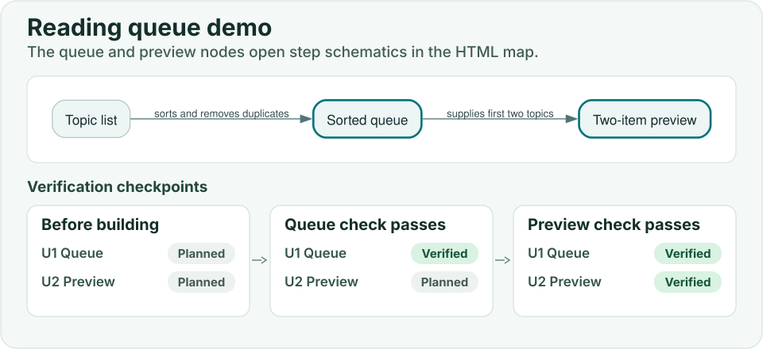

# X-ray

X-ray keeps one navigable architecture map with a linked schematic for each step in an implementation plan. It records the evidence behind each verified step and renders the map and schematics as local HTML.

## What X-ray produces

The final map from the reading queue demo links the sorted queue and two-item preview to their step schematics. The checkpoints show the statuses before work, after the queue check, and after the preview check.

Open a step in the live HTML map to see its inputs, output, source plan, and verification evidence. The preview step also links back to the queue step it depends on. [Run the reading queue demo](skills/x-ray/references/demo.md)

## Install

Copy [the skills/x-ray directory](skills/x-ray/) into your agent's skills directory. For a fresh Codex install, place it at **~/.codex/skills/x-ray/**. For Claude Code, use **~/.claude/skills/x-ray/**. Keep the directory structure intact and start a new agent session.

The renderer needs Python 3.9 or later and Graphviz. Check that the **dot** command is on your PATH.

## Try it

Ask your agent to use X-ray to map an implementation plan and refresh each step as it is verified. The [reading queue demo](skills/x-ray/references/demo.md) runs through two steps in a scratch directory and produces a map with links to both schematics.

X-ray also supports [project opt-in for ongoing updates](skills/x-ray/references/project.md) during Compound Engineering or other implementation work.

[MIT license](LICENSE)
